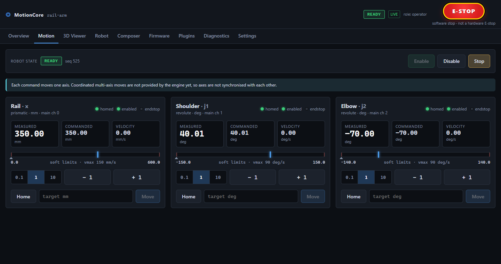
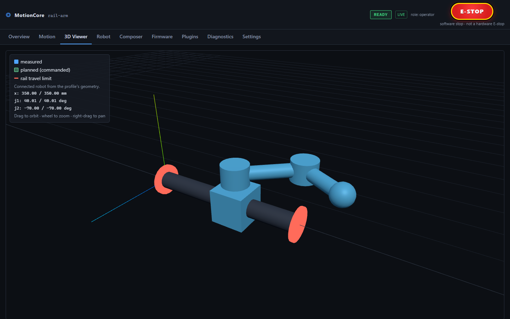
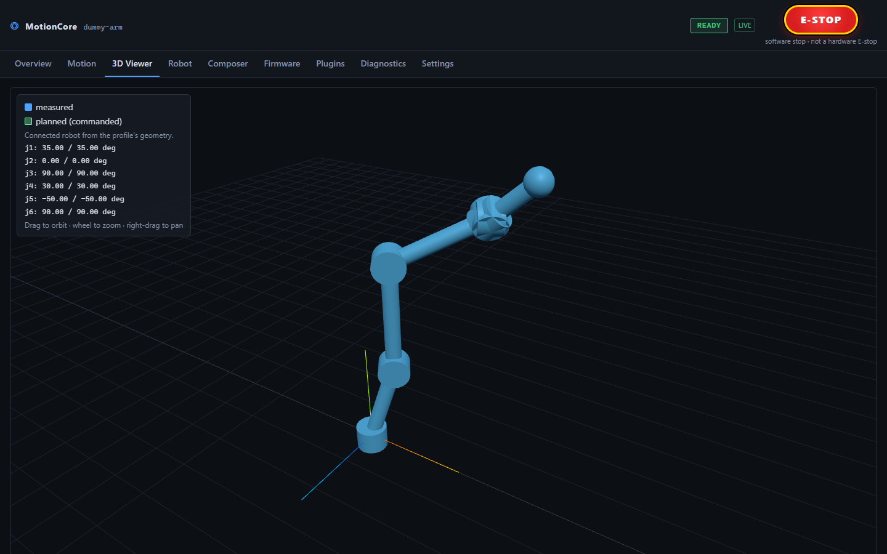
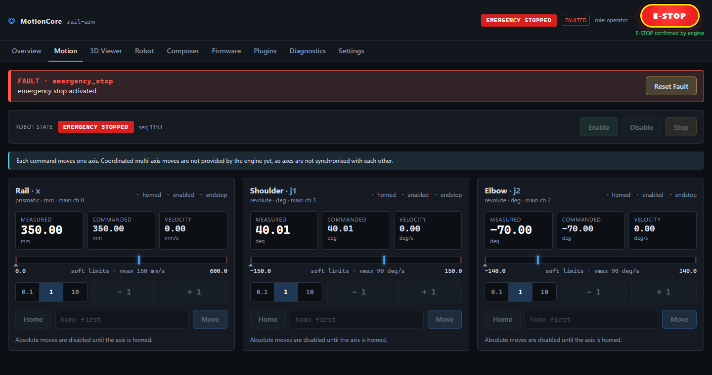
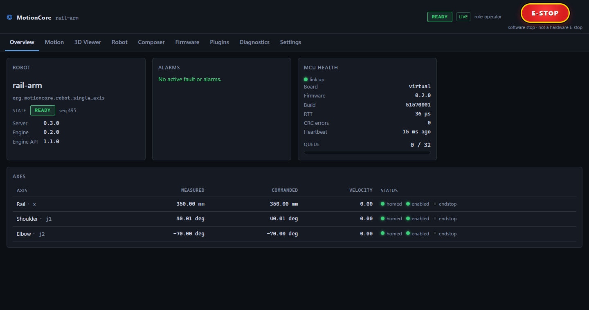
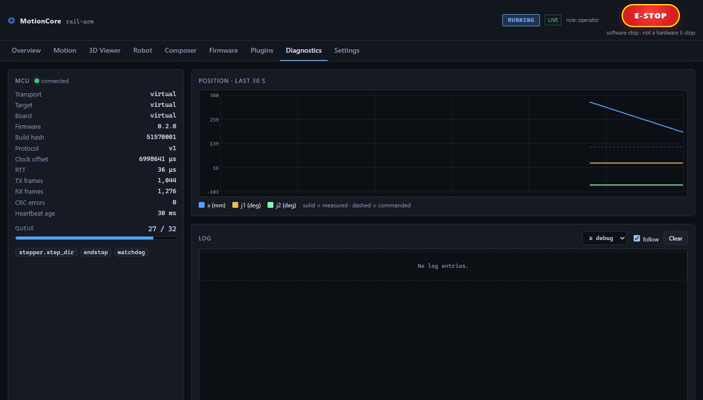
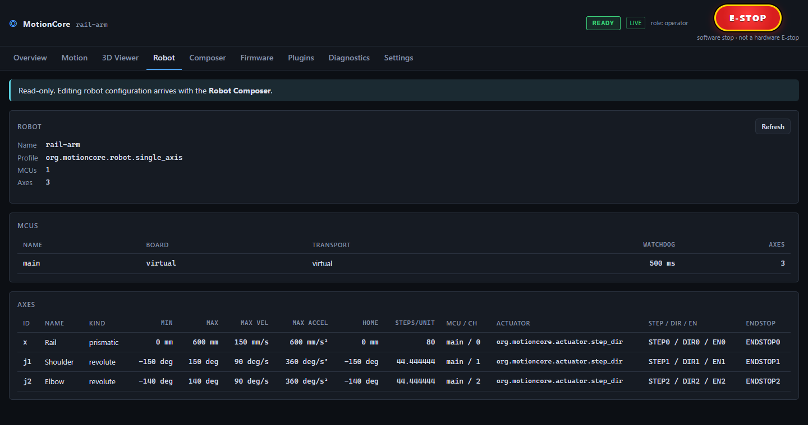
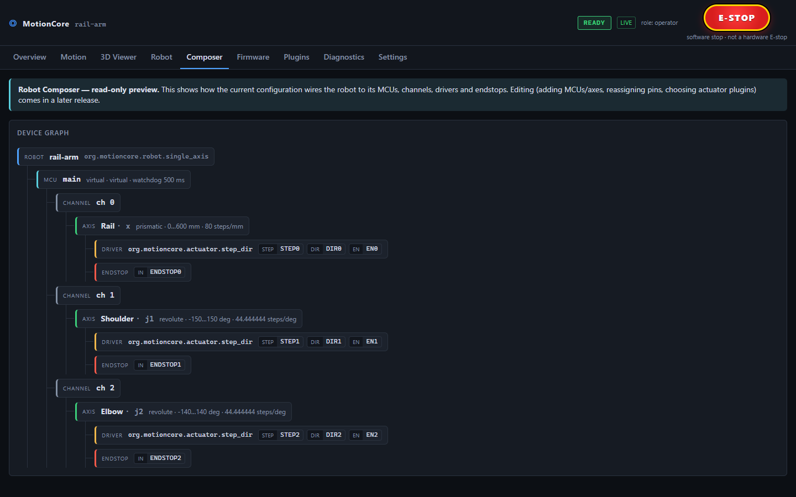
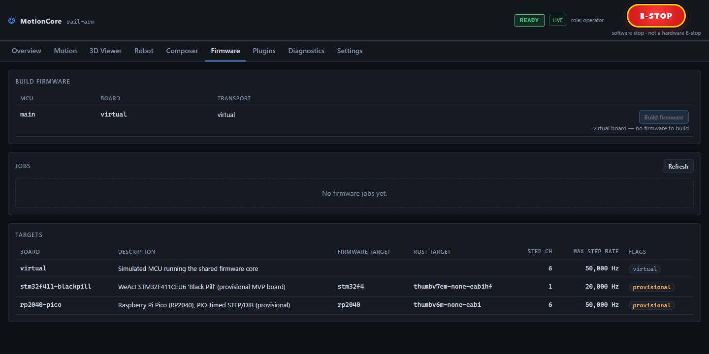

# sindrava

**Website & docs: [sindrava.bzy-logics.com](https://sindrava.bzy-logics.com)** · Engine: [motioncore.bzy-logics.com](https://motioncore.bzy-logics.com) · Gateway: [ratavyr.bzy-logics.com](https://ratavyr.bzy-logics.com)

Operator UI for MotionCore. Vite + React 19 + TypeScript (strict) + plain Three.js, plain CSS.

MotionCore is split into three repos:

| repo | role |
|---|---|
| `motioncore` | Rust motion engine — the state authority |
| `ratavyr` | Go REST/WebSocket gateway in front of the engine |
| `sindrava` | this UI |

**This UI is a replaceable client.** It talks only to `ratavyr` over the public
HTTP API, holds no robot logic of its own and never synthesises robot state. Every command
is validated by the server/engine; the UI's button enablement is only a convenience. Any other
HTTP client (scripts, HMI panels, a different frontend) can use the same API.

## Screenshots

Taken from the running stack (sindrava → ratavyr → motioncore engine → virtual MCU) with motioncore's
`robot-profiles/rail-arm-virtual.toml`: a two-link arm carried by a linear rail. No hardware involved.

**Motion** — enable/disable/stop, per-axis jog, home and absolute moves, commanded vs. measured position
within the soft limits. The E-STOP in the header is on every screen.



**3D Viewer** — the robot as one connected machine, built from the profile's kinematic geometry: the arm
rides on the rail carriage, links run joint to joint. Measured pose solid, commanded pose as a ghost.



The same viewer with a simulated six-axis desktop arm (MotionCore's `robot-profiles/dummy-arm-virtual.toml`):



**Emergency stop** — after an E-STOP the engine reports `emergency_stopped`; motion controls are disabled,
homing is forgotten and the fault must be reset before the drives can be enabled again.



| Overview | Diagnostics |
|---|---|
|  |  |
| **Robot** | **Composer** |
|  |  |
| **Firmware** | |
|  | |

## API contract

The contract is **`ratavyr/docs/rest-api.md` (v1)**. `src/types/api.ts` mirrors it
type-for-type and `src/api/` implements it:

- `src/api/client.ts` — typed REST client (`/health`, `/info`, `/session`, `/status`, `/config`,
  `/plugins`, `/commands/{name}`, `/ws-tickets`, `/firmware/*`), error envelope parsing
  (`{"error":{"code","message"}}` → `ApiError`)
- `src/api/ws.ts` — `/api/ws` client (engine/telemetry/log messages) with exponential backoff + jitter;
  authenticates with a fresh single-use ticket per connection
- `src/api/auth.ts` — API token storage

Older servers (ratavyr < 0.3, without `/api/session` and `/api/ws-tickets`) still work: permissions
are then unknown (the server still enforces them) and the WebSocket falls back to `?access_token=`.

When the contract changes, update `src/types/api.ts` first; `npm run typecheck` then shows every
place that needs attention.

## Run

```sh
npm install
npm run dev        # http://localhost:5173, proxies /api (REST + WebSocket) to http://127.0.0.1:8080
npm run typecheck  # tsc only
npm test           # vitest: unit tests, jsdom UI tests (E-stop, confirmations, permissions)
npm run build      # tsc + production build into dist/
npm run preview    # serve dist/ locally
```

**Development:** start `ratavyr` on `127.0.0.1:8080`, then `npm run dev`.

**Production:** `npm run build` and let `ratavyr` serve `dist/` (it serves a web directory at `/`
with SPA fallback), so UI and API share one origin. Any static host works as long as `/api` (including the
WebSocket upgrade on `/api/ws`) is reverse-proxied to the server on the same origin.

## Authentication and roles

If the server has API tokens configured, every endpoint except `GET /api/health` and `GET /api/info`
requires one. `/api/info` reports `auth_required`; `/api/session` reports the token's role
(`viewer`, `operator`, `admin`) and permissions.

- Enter the token under **Settings** (or in the banner that appears). By default it is kept for this
  tab only (`sessionStorage`); tick **remember on this device** to keep it in `localStorage`.
- REST requests send `Authorization: Bearer <token>`. The WebSocket gets a single-use, 30-second ticket
  from `POST /api/ws-tickets` before every (re)connect, so the token never appears in a URL.
- Controls the role may not use are disabled with an explanation (a viewer can watch and stop, an
  operator can command motion and build firmware, only an admin can flash). The server enforces the
  same rules.
- Any `401` response shows an auth banner prompting for the token; `403` shows as a failed action.

## Safety behaviour

- **E-STOP** is in the header on every screen and is never disabled. After a click it shows
  "Accepted, waiting for engine confirmation…" and only reports **confirmed** once engine telemetry
  says `emergency_stopped`. If the request fails, or no confirmation arrives within 2 s, it tells the
  operator to use the hardware emergency stop. The button is labelled as a software stop: it is not a
  substitute for an independent hardware E-stop circuit.
- **Confirmations** before Enable (energises drives), Home (moves the axis) and Reset fault. Cancel has
  the focus, so Enter/Escape never confirm by accident. Flashing keeps its "drives are powered off"
  check box.
- **Connection status** in the header: `live`, `reconnecting` (API WebSocket down), `disconnected` (API or
  engine unreachable, with the engine's reason, e.g. an incompatible API version), `stale` (no telemetry
  for 1.5 s) and `faulted`. Motion controls are disabled unless the data is live and fresh.
- The UI never synthesises robot state: everything shown comes from engine telemetry.

## Screens

| Tab | Contents |
|---|---|
| Overview | Robot name/profile, state, active fault + derived alarms, MCU health summary, axis summary |
| Motion | Enable/Disable/Stop, Reset Fault, Home all (the engine's home-all plan, axes of a step together; confirmed with steps and start pose; cancellable; sequential with engines before API 1.2), per-axis jog/home/absolute move (homed axes only), soft-limit bars with commanded vs. measured position. Axes are commanded one at a time (the engine has no coordinated multi-axis moves yet) |
| 3D Viewer | Click a joint to select it, drag it to preview a target (amber, nothing sent), press Move to send one `move_to`; jog buttons in the joint panel. Previews that would make the robot collide with itself turn red and cannot be sent (profiles with link `radius`, engine-api ≥ 1.2; the engine checks again). Connected robot from the profile's `[axis.geometry]` (parent joints, offsets, joint axes; engine-api ≥ 1.1), or each axis on its own when the profile has no geometry. Measured pose solid, commanded pose as ghost; camera framed on the robot; lazy-loaded (three.js is its own chunk) |
| Robot | Read-only RobotConfig: MCUs, axes, limits, actuator, pins |
| Composer | Read-only device graph Robot → MCU → channel → axis → driver (actuator, step/dir/enable) + endstop. Editing comes later |
| Firmware | Targets, "Build firmware" per configured MCU (virtual boards disabled), jobs with state/log/artifact (build hash, SHA-256), "Flash" for succeeded builds behind an explicit "drives are powered off" confirmation |
| Plugins | Plugin table with description, permissions, state and error |
| Diagnostics | MCU link details (board, build hash, …), queue bar, 30 s position chart, filtered log |
| Settings | API token (tab-only or remembered), role, server/engine versions |

The active tab is kept in the URL hash (`#firmware`, …). The red **E-STOP** button is in the header on every
screen and is never disabled.

## Tests

```sh
npm run typecheck
npm test
npm run build
```

End-to-end, against a running stack (ratavyr + engine with the virtual MCU,
`robot-profiles/single-axis-virtual.toml`), using this app's own REST and WebSocket clients:

```sh
MOTIONCORE_E2E_URL=http://127.0.0.1:8080 MOTIONCORE_E2E_OPERATOR_TOKEN=... MOTIONCORE_E2E_VIEWER_TOKEN=... npx vitest run src/e2e
```

CI ([.github/workflows/ci.yml](.github/workflows/ci.yml)) runs typecheck, tests and build, and the
end-to-end test against freshly built motioncore and ratavyr.

## Known limitations and engine dependencies

- **Robot Composer is read-only.** The engine has no configuration editing or validation API; robot
  profiles are TOML files loaded when the engine starts.
- **3D viewer** draws a connected robot only when the robot profile defines geometry for every axis
  (`[axis.geometry]`, engine-api ≥ 1.1). Otherwise each axis is shown on its own, because how the axes
  are mounted is unknown. Link shapes are schematic (cylinders between joints); there are no meshes.
- **No coordinated multi-axis motion** and no planned-trajectory preview: the engine moves one axis per
  command. Commanded vs. measured position is shown per axis.
- **Firmware verify** (running build vs. artifact) is CLI-only in the engine.
- One MCU per robot in telemetry (engine-api v1).

## Layout

```
src/
  app/          shell, navigation, header (E-STOP), connection/auth banners, settings, styles
  components/   shared UI: badges, LEDs, chips, panels, dialog, toasts
  features/     dashboard, motion (control + 3D viewer), robots, composer, firmware, plugins, diagnostics
  api/          REST + WebSocket clients, auth token store, backoff
  hooks/        live store (useEngine / useTelemetry / useAuth), usePolling, useCommand
  types/        API contract types
public/         static assets
```

## License

Copyright (C) 2026 bzy-logics

This program is free software: you can redistribute it and/or modify it under
the terms of the GNU General Public License as published by the Free Software
Foundation, version 3. It is distributed in the hope that it will be useful,
but WITHOUT ANY WARRANTY; without even the implied warranty of MERCHANTABILITY
or FITNESS FOR A PARTICULAR PURPOSE. See [LICENSE](LICENSE) for the full text
(SPDX: `GPL-3.0-only`).
